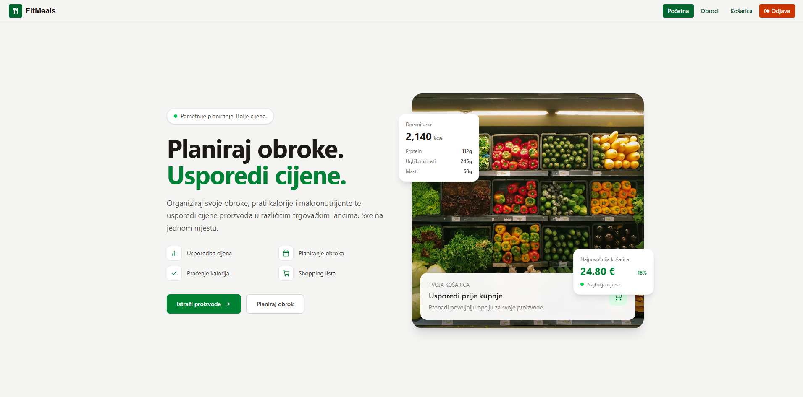
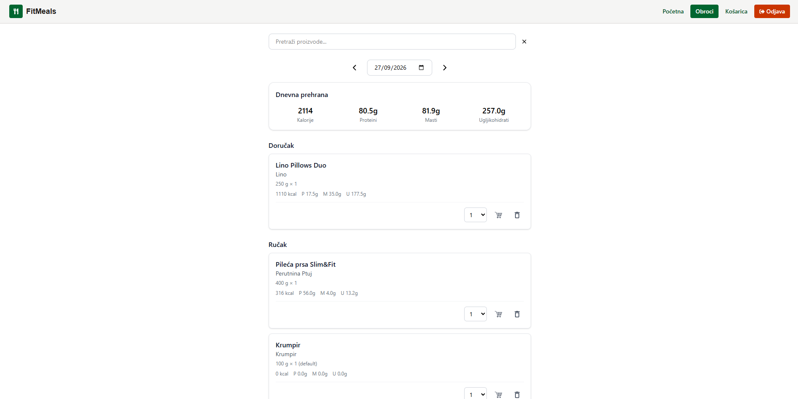
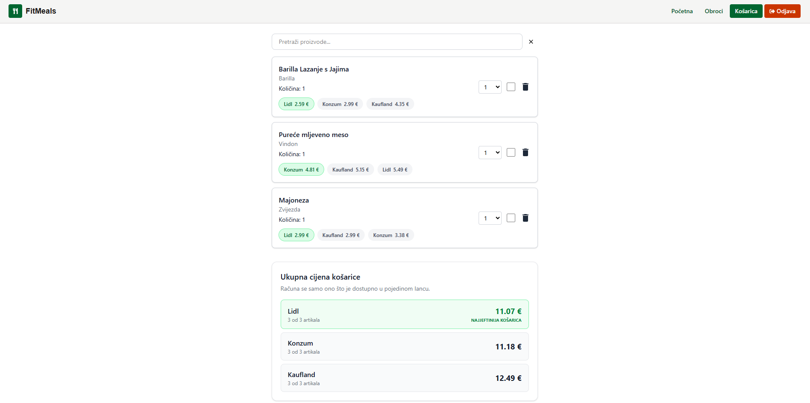

# SmartMeal

SmartMeal je web aplikacija za planiranje obroka i pametniju kupovinu namirnica. Omogućuje pretraživanje proizvoda, usporedbu cijena u trgovačkim lancima, planiranje obroka uz izračun kalorija i upravljanje popisom za kupovinu.

🔗 **Produkcijska aplikacija:** https://smartmeals.gabrieljanjic.com

## Screenshots







---

## Značajke

- 🔍 **Pretraživanje namirnica** putem integracije s [cijene.dev](https://cijene.dev) API-jem.
- 💰 **Usporedba cijena** proizvoda u Konzumu, Lidlu i Kauflandu, ovisno o dostupnim podacima API-ja.
- 🍽️ **Planiranje obroka** po danima, uz dodavanje namirnica i uređivanje količina.
- 🔥 **Izračun kalorija** na temelju namirnica i njihovih nutritivnih vrijednosti.
- 🛒 **Košarica za kupovinu** s automatskim izračunom ukupne cijene.
- ✅ **Praćenje kupovine** označavanjem kupljenih proizvoda i uređivanjem stavki.
- 🔐 **Autentifikacija korisnika** putem JWT-a u HttpOnly cookieju.

---

## Tehnologije

### Frontend

- React
- TypeScript
- Vite
- Axios
- Nginx za posluživanje produkcijske aplikacije

### Backend

- C# / .NET ASP.NET Core Web API
- Entity Framework Core
- JWT autentifikacija putem HttpOnly cookieja

### Baza podataka

- Microsoft SQL Server 2022

### Vanjski servisi

- [cijene.dev](https://cijene.dev) — dohvat podataka o cijenama proizvoda.
- [Open Food Facts](https://world.openfoodfacts.org) — dohvat nutritivnih vrijednosti proizvoda prema EAN kodu.

---

## Arhitektura i produkcija

Aplikacija je trenutačno hostana na **Hetzner Cloud** serveru, a servisi se pokreću pomoću Docker Composea.

- **Frontend:** React aplikacija koju poslužuje Nginx.
- **Backend:** ASP.NET Core Web API u Docker kontejneru.
- **Baza podataka:** Microsoft SQL Server u zasebnom Docker kontejneru.
- **HTTPS:** Nginx terminira HTTPS promet i prosljeđuje API zahtjeve backendu.
- **DNS i proxy:** Cloudflare.
- **Domena:** [smartmeals.gabrieljanjic.com](https://smartmeals.gabrieljanjic.com).

Pojednostavljeni tijek zahtjeva:

```text
Korisnik
   |
   v
Cloudflare / HTTPS
   |
   v
Nginx
   |-- Frontend
   |
   |-- /api/* --> ASP.NET Core API
                       |
                       v
                  SQL Server
```

Frontend i backend dio su istog repozitorija, a produkcijski servisi definirani su u `docker-compose.yml`.

---

## CI/CD — automatska objava

Projekt koristi GitHub Actions za automatizaciju objave na produkcijski server.

Workflow se nalazi u:

`.github/workflows/deploy.yml`

Kada se promjene pošalju na granu `main`, workflow:

1. Povezuje se na Hetzner server putem SSH-a.
2. Preuzima najnovije promjene s GitHuba.
3. Izgrađuje i pokreće ažurirane Docker servise naredbom `docker compose up -d --build`.

Status automatizacije može se pratiti u [GitHub Actions](https://github.com/gabrieljanjic/smartmeal/actions).

---

## API dokumentacija

Produkcijski API dostupan je preko domene aplikacije:

`https://smartmeals.gabrieljanjic.com/api`

### Autentifikacija

| Metoda | Ruta                 | Opis                                   |
| ------ | -------------------- | -------------------------------------- |
| GET    | `/api/Auth/me`       | Dohvat trenutno prijavljenog korisnika |
| POST   | `/api/Auth/register` | Registracija korisnika                 |
| POST   | `/api/Auth/login`    | Prijava korisnika                      |
| POST   | `/api/Auth/logout`   | Odjava korisnika                       |

### Obroci i namirnice

| Metoda | Ruta                      | Opis                            |
| ------ | ------------------------- | ------------------------------- |
| GET    | `/api/meal-items`         | Dohvat stavki obroka            |
| POST   | `/api/meal-items`         | Dodavanje namirnice u obrok     |
| PUT    | `/api/meal-items/{id}`    | Ažuriranje stavke obroka        |
| DELETE | `/api/meal-items/{id}`    | Brisanje stavke obroka          |
| GET    | `/api/Products`           | Pretraživanje proizvoda         |
| GET    | `/api/Products/{eanCode}` | Dohvat proizvoda prema EAN kodu |

### Košarica za kupovinu

| Metoda | Ruta                                | Opis                                |
| ------ | ----------------------------------- | ----------------------------------- |
| GET    | `/api/shopping-cart`                | Dohvat stavki košarice              |
| POST   | `/api/shopping-cart`                | Dodavanje stavke                    |
| PUT    | `/api/shopping-cart/{id}/amount`    | Promjena količine                   |
| PUT    | `/api/shopping-cart/{id}/bought-at` | Označavanje proizvoda kao kupljenog |
| DELETE | `/api/shopping-cart/{id}`           | Uklanjanje stavke                   |

### Upravljanje korisnicima — Admin

Rute za upravljanje korisnicima nalaze se pod `/api/User`. Administratorske rute zahtijevaju autentifikaciju i odgovarajuću ulogu `Admin`.

| Metoda | Ruta                          | Opis                                      | Ovlasti |
| ------ | ----------------------------- | ----------------------------------------- | ------- |
| GET    | `/api/User`                   | Dohvat svih korisnika                     | Admin   |
| PUT    | `/api/User/{id}/toggle-admin` | Promjena administratorske uloge korisnika | Admin   |
| DELETE | `/api/User/{id}`              | Brisanje korisnika                        | Admin   |

Zaštićene rute zahtijevaju odgovarajuću autentifikaciju. Detalji zahtjeva i odgovora ovise o implementaciji API-ja.

---

## Licenca

Projekt je izrađen u edukativne i portfolio svrhe.
